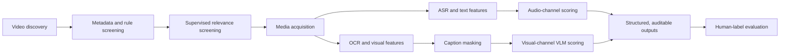

# Multimodal AI Pipeline for TikTok Health Videos

An end-to-end system for collecting, screening, processing, and assessing TikTok health videos with speech recognition, OCR, computer vision, and multimodal AI.

I independently designed and built this project from May 2026 to the present. It began with a corpus of approximately 3,000 videos covering a specific health topic on TikTok. The system turns raw platform videos into traceable, structured assessments through a resumable pipeline designed for long-running media and model workloads.

Rather than committing to one model early, I treated model selection as an engineering process: establish a baseline, isolate one variable at a time, evaluate against manually reviewed examples, inspect disagreement cases, and promote an approach only when its benefit justified its cost and complexity.

## System architecture

## What I built

- **A staged data pipeline** that combines transparent screening rules with a supervised TF-IDF and logistic-regression classifier over metadata, descriptions, and transcripts.
- **Multimodal feature extraction** using Whisper ASR, frame sampling, OCR, visual statistics, and caption-masked media.
- **Independent evidence channels** for speech, non-caption on-screen text, and visual content, preventing one modality from silently answering for another.
- **Hybrid AI scoring** that combines deterministic guardrails with Gemini 3.8 Flash for semantic and visual judgments.
- **Resumable batch execution** keyed by stable video IDs, with cross-batch artifact reuse, incremental checkpoints, persistent failure records, and cached model responses.
- **Auditable decisions** that preserve the label, confidence, evidence, reason code, method, and source fields for every scoring decision.
- **Evaluation tooling** for per-item confusion matrices, precision, recall, F1, paired comparisons, bootstrap analysis, and evidence-level disagreement review.

## Engineering evolution

### 1. Separating captions from visual information

Burned-in captions repeat the audio channel, so treating them as independent visual evidence would contaminate downstream multimodal measurements. I built an OCR-based classifier that identifies whether captions appear in the upper or lower region of a video while preserving titles, diagrams, and persistent credential cards.

The first version relied on layout: persistent, nearly full-width text bands were treated as captions. I then introduced an orthogonal content signal based on the observation that captions should overlap with the ASR transcript. I compared sequence similarity, token Jaccard similarity, and directional token coverage. Coverage handled short text fragments most effectively, while a minimum-token gate prevented accidental matches from single common words.

I tuned the similarity threshold and minimum-token requirement over a cached OCR dataset, using F0.5 because removing legitimate visual information was more costly than retaining a caption for later review. A persistence filter protected static overlays that shared vocabulary with the narration. After changing the OCR backend and retuning the detector, development-set F1 improved from **0.44 to 0.98**.

The validation extended beyond classifier metrics. I rendered before-and-after frames and inspected the applied pixel masks, which caught implementation issues that aggregate scores could not expose. OCR boxes are extracted once and cached, so parameter searches and downstream scorers do not repeat the expensive vision step.

### 2. Testing whether to replace the model or the architecture

I used a controlled two-arm experiment to determine whether visual scoring quality was constrained by the language model or by the surrounding rule architecture.

In the first arm, I wrote a compatibility adapter that redirected the existing local-model requests to a stronger hosted model while keeping the prompts, rules, thresholds, and post-processing unchanged. This isolated the contribution of the model itself.

In the second arm, Gemini reviewed a sequence of caption-masked frames and returned all scoring items in one structured response. I iterated the rubric through error analysis: shortened an overly verbose prompt, restored necessary task-specific definitions, required affirmative visible evidence, and added a deterministic insufficient-evidence gate. Returning to the source scoring guide also revealed a general decision rule that applied across items and was more reliable than item-by-item prompt expansion.

The selected VLM architecture improved development-set macro F1 by approximately **0.08** over the original pipeline. The result changed the production design from separate hand-built rule chains with occasional model fallback to multimodal reasoning with targeted deterministic guardrails.

### 3. Validating model selection with counterfactual tests

Before selecting a general-purpose VLM, I prototyped YOLO-based device detection and evaluated SigLIP, ViCLIP, InternVideo2, MiniLM, and a reproduction of a published cross-modal matching method.

Aggregate similarity scores alone were not enough to choose a production approach, so I designed negative controls that deliberately paired each video with another video's transcript. This transcript-swap test separated genuine content alignment from signals driven by temporal density, position, or overall video style. I also compared within-video and across-video behavior instead of relying on one pooled metric.

These diagnostics guided the production choice toward explicit VLM judgments over individual information units. Specialized vision and embedding models remain isolated prototypes, keeping exploratory dependencies out of the main pipeline while preserving the experiments and decision trail.

### 4. Reducing multimodal inference cost while preserving quality

The first VLM configuration used a higher-tier model, one frame per second, high-resolution video, and additional OCR text. I built a paired evaluation harness that changed one variable at a time while reusing the same annotated units and cached control outputs.

The comparison covered model tier, OCR inclusion, frame rate, media resolution, input format, and request aggregation. The selected production configuration uses Gemini 3.8 Flash, removes redundant OCR input, samples video at **0.5 fps** with medium-resolution processing, and sends frames as a silent video rather than as individually billed images. Video-side token usage fell by **88%** without a decrease in the paired accuracy checks.

Caption-masked screenshots are assembled into a silent MP4, preserving evidence isolation at nearly the same token cost as the original video. All scoring items are returned in one request per video, and inexpensive deterministic checks run before additional VLM inference when appropriate. A one-frame fast path handles straightforward visual cases and adds more frames only when needed.

Responses are cached by model, prompt hash, video ID, and scoring item. A completed workflow can be replayed without new API calls, while billing and quota responses stop the batch instead of entering an unproductive retry loop. The resulting configuration produced complete outputs for **935 of 942** production videos.

## Reliability design

Long media jobs exposed failure modes that do not appear in small notebook tests. I moved Whisper behind a killable worker process with a line-based JSON protocol, per-video timeouts, automatic restarts, and a separate record for permanently undecodable inputs. Interrupted runs resume from completed artifacts rather than repeating downloads, transcription, OCR, or model inference.

I also separate processing errors from legitimate empty results. This matters for GPU-backed OCR: a failed inference must never become indistinguishable from “no text detected.” The pipeline records explicit failure states, monitors error rates, sizes concurrency around the actual bottleneck, and compares new artifacts with prior outputs before accepting a rerun.

## Technology

**Languages and data:** Python, pandas, NumPy, JSON, CSV, Jupyter  
**ML and AI:** Gemini, Whisper, scikit-learn, Ollama, ViCLIP, InternVideo2, SigLIP, MiniLM, YOLO  
**Media and vision:** OpenCV, RapidOCR, Tesseract, FFmpeg, yt-dlp  
**Engineering:** subprocess isolation, structured model outputs, content-addressed caching, checkpointed batch processing, Git worktrees

## Evaluation note

The metrics above are development-set engineering measurements used to compare pipeline designs. They describe implementation and model-selection decisions rather than research findings.

## Code availability

The implementation and data are private due to research confidentiality. I can walk through the architecture, reliability mechanisms, model-selection experiments, and AI engineering tradeoffs in an interview.