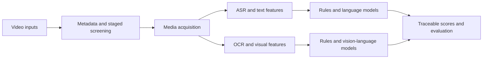

# Multimodal Health Video Assessment

An end-to-end AI pipeline that screens short-form health videos and assesses their educational quality from speech, on-screen text, and visual evidence.

I designed and built the full system: data ingestion, staged screening, media processing, multimodal feature extraction, automated scoring, failure recovery, and evaluation tooling. The design focuses on reliable long-running jobs, traceable model decisions, and efficient use of AI inference.

## Architecture

## Engineering highlights

- **Resumable data pipeline:** Reuses artifacts across batches, deduplicates work by stable video ID, caches expensive features, and checkpoints progress for safe restarts.
- **Fault-tolerant media processing:** Isolates speech recognition in killable worker processes with per-file timeouts, automatic restarts, and persistent failure tracking.
- **Cost-aware AI orchestration:** Resolves clear cases with deterministic rules, then selectively escalates ambiguous cases to language or vision-language models. Visual inference uses a one-frame fast path before loading more evidence.
- **Multimodal evidence controls:** Separates audio and visual channels and detects and masks speech captions so visual scoring does not reuse transcript evidence.
- **Reliable model integration:** Enforces bounded retries, request timeouts, structured JSON parsing, label validation, and graceful fallbacks around model calls.
- **Auditable decisions:** Emits the label, confidence, evidence, reason code, method, and source fields for each scoring decision.
- **Evaluation workflow:** Joins automated outputs with human annotations and produces per-item confusion counts, precision, recall, and F1 for iteration and regression checks.

## Technology

Python · pandas · NumPy · scikit-learn · Whisper · OpenCV · RapidOCR · Tesseract · Ollama · Jupyter

## Code availability

The implementation is private due to research confidentiality. I can walk through the architecture, reliability design, and AI engineering tradeoffs in an interview.